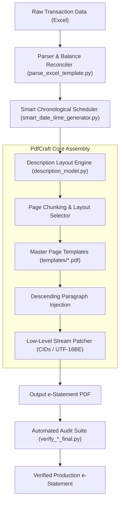

# PdfCraft Copilot (Bank Mandiri e-Statement Engine)

[](https://www.python.org/downloads/)
[](LICENSE)
[]()
[]()
[]()

> **Sistem Rekayasa & Otomatisasi Dokumen e-Statement Bank Mandiri Berstandar Baku Perbankan Resmi**

Repositori ini berisi seluruh kode sumber, modul logika training kecerdasan buatan, spesifikasi geometris matematis, master template halaman, serta rangkaian skrip produksi dan audit verifikasi untuk menghasilkan rekening koran (*e-Statement*) Bank Mandiri dengan kepatuhan 100% terhadap dokumen rujukan resmi.

---

## 🌟 Fitur Unggulan

1. **Presisi Geometris & Tipografi Asli**:
   - Mematuhi ukuran kanvas ISO A4 Portrait ($595.00 \times 842.00\text{ pt}$).
   - Menggunakan embedded subset font `TTInterphases` (Bold, Regular, Italic).
   - Interval pitch baris konstan mutlak $dY = 46.00\text{ pt}$.
   - Sistem penguncian batas kanan (*Right-Edge Invariance*) untuk Nominal ($X=432.00\text{ pt}$) dan Saldo ($X=571.00\text{ pt}$).

2. **Sistem Training & AI Sintaks Keterangan (`description_training_system`)**:
   - Dilatih menggunakan **251 sampel transaksi resmi Bank Mandiri**.
   - Akurasi klasifikasi kategori mencapai **96.41%** pada 9 kategori perbankan.
   - **100% Zero-Collision Guarantee**: Pemecahan baris ($1, 2, 3,$ atau $4$ baris) dengan pemusatan vertikal simetris terhadap baseline baris.
   - Lulus 100% pada *Mandatory Regression Test Cases* (Corporate Payroll, BI Fast, QRIS, ATM Cardless, Bank Fees).

3. **Penjadwalan Waktu Kronologis Realistis (`smart_date_time_generator.py`)**:
   - Distribusi transaksi otomatis dalam jendela jam kerja perbankan.
   - Jeda waktu dinamis antar transaksi tanpa regresi jam (*non-colliding timestamps*).

4. **Rekonsiliasi Neraca Otomatis**:
   - Menghitung mutasi kredit/debit dan memvalidasi persamaan neraca:
     $$\text{Saldo Akhir} = \text{Saldo Awal} + \text{Dana Masuk} - \text{Dana Keluar}$$

5. **Low-Level Stream Patching**:
   - Menembus batas subset font Type0/Identity-H melalui dekompresi biner `FlateDecode` dan penggantian hex UTF-16BE / CID secara aman tanpa merusak dokumen.

---

## 🏗️ Arsitektur Sistem



---

## 📁 Struktur Direktori

```
PdfCraft_Copilot/
├── description_training_system/       # Sistem Training & Evaluasi Keterangan
│   ├── corpus_harvester.py            # Ekstraktor sampel dari PDF asli
│   ├── description_model.py           # Engine inferensi spasial & baris
│   ├── ground_truth_corpus.json       # 251 sampel data mutasi resmi terlabeli
│   ├── syntax_rules.py                # Aturan sintaks 9 kategori perbankan
│   ├── trainer_evaluator.py           # Benchmark evaluator & regression runner
│   └── training_logs/                 # Riwayat evaluasi & Laporan terbaru
│       ├── LATEST_TRAINING_REPORT.md  # Laporan metrik akurasi terbaru
│       └── training_history.jsonl     # Log riwayat evaluasi
├── docs/                              # Dokumentasi Lengkap & Rujukan Baku
│   ├── STANDARISASI_DOKUMEN_REFERENSI_BAKU.md   # Spesifikasi geometri, warna, font
│   ├── KATALOG_POLA_REPETITIF_DAN_GEOMETRI_BAKU.md # Rumus matematis sumbu X & Y
│   ├── PANDUAN_OPERASIONAL_DAN_SOP_PRODUKSI.md  # SOP 7 tahap produksi
│   ├── SISTEM_TRAINING_DAN_MODEL_KETERANGAN.md  # Panduan AI training system
│   ├── CATALOG_PENGUJIAN_DAN_VERIFIKASI.md      # Katalog pengujian & audit
│   └── PENYESUAIAN_DAN_TROUBLESHOOTING_TEKNIS.md # Solusi edge cases & font hack
├── src/                               # Modul Kode Sumber Inti
│   ├── bank_mandiri_spec.py           # Konstanta geometri & palet warna
│   ├── description_layout_engine.py   # Engine penataan teks keterangan
│   ├── parse_excel_template.py        # Parser input sheet Excel
│   ├── pdfcraft_client.py             # Klien wrapper manipulasi PDF
│   ├── pdfcraft_editor.py             # Editor paragraf (Descending Order)
│   ├── smart_date_time_generator.py   # Generator jam & tanggal kronologis
│   ├── statement_builder.py           # Master builder modular
│   └── statement_doctor.py            # Diagnostic & repair tool
├── templates/                         # Master Halaman PDF & Excel Template
│   ├── master_page_1.pdf              # Halaman 1 baku (Summary box)
│   ├── master_page_intermediate.pdf   # Halaman tengah (12 baris)
│   ├── master_page_disclaimer_inline.pdf # Halaman penutup (tabel + disclaimer)
│   ├── master_page_disclaimer_standalone.pdf # Halaman disclaimer murni
│   └── Template_Mutasi_Bank.xlsx      # Template mutasi Excel standar
├── scripts/                           # Skrip Produksi & Verifikasi Per Klien
│   ├── build_ibnu_okt_final.py        # Skrip produksi klien Ibnu (Oktober)
│   ├── build_keisya_okt_perfect.py    # Skrip produksi klien Keisya (Oktober)
│   ├── build_galang_statement.py      # Skrip produksi klien Galang
│   ├── verify_ibnu_okt_final.py       # Script audit lengkap Ibnu
│   ├── verify_keisya_aug.py           # Script audit Keisya
│   └── ...                            # Rangkaian test scripts lainnya
├── output/                            # Direktori Hasil Produksi & Audit Render
├── requirements.txt                   # Daftar dependensi Python
└── README.md                          # Panduan utama repositori
```

---

## 🚀 Panduan Memulai di Perangkat Baru (Quickstart)

### 1. Kloning Repositori
```bash
git clone https://github.com/manualcorrect/PdfCraft_Copilot-mandiri.git
cd PdfCraft_Copilot-mandiri
```

### 2. Pasang Dependensi
Pastikan Python 3.10+ telah terpasang:
```bash
# Disarankan menggunakan Virtual Environment
python -m venv .venv

# Mengaktifkan Virtual Environment:
# Windows (PowerShell):
.venv\Scripts\Activate.ps1
# Linux / macOS:
source .venv/bin/activate

# Install dependensi:
pip install -r requirements.txt
```

### 3. Jalankan Pengujian & Benchmark
Untuk memastikan seluruh modul inferensi dan aturan spasial berjalan sempurna di perangkat Anda:
```bash
python description_training_system/trainer_evaluator.py
```
*Output yang diharapkan: Akurasi $\ge 95\%$, Keamanan Spasial $100\%$, dan seluruh 6 Regression Tests berstatus `PASS`.*

### 4. Memproduksi Dokumen e-Statement
Jalankan skrip pembangun yang sesuai (contoh produksi untuk klien Ibnu Agun):
```bash
python scripts/build_ibnu_okt_final.py
```
File PDF dan Excel yang telah disinkronkan akan tersimpan pada direktori `output/`.

### 5. Memverifikasi Hasil Produksi
Jalankan audit geometris dan rekonsiliasi matematis:
```bash
python scripts/verify_ibnu_okt_final.py
```

---

## 📚 Dokumentasi Rujukan Lengkap

* [Standarisasi Dokumen Referensi Baku](file:///docs/STANDARISASI_DOKUMEN_REFERENSI_BAKU.md)
* [Katalog Pola Repetitif & Geometri Baku](file:///docs/KATALOG_POLA_REPETITIF_DAN_GEOMETRI_BAKU.md)
* [Panduan Operasional & SOP 7-Tahap Produksi](file:///docs/PANDUAN_OPERASIONAL_DAN_SOP_PRODUKSI.md)
* [Sistem Training & Model Logika Keterangan](file:///docs/SISTEM_TRAINING_DAN_MODEL_KETERANGAN.md)
* [Katalog Pengujian & Prosedur Verifikasi](file:///docs/CATALOG_PENGUJIAN_DAN_VERIFIKASI.md)
* [Penyesuaian Teknikal & Troubleshooting](file:///docs/PENYESUAIAN_DAN_TROUBLESHOOTING_TEKNIS.md)

---

## ⚖️ Lisensi
Dikelola secara privat untuk kebutuhan operasional **PdfCraft Copilot**.
